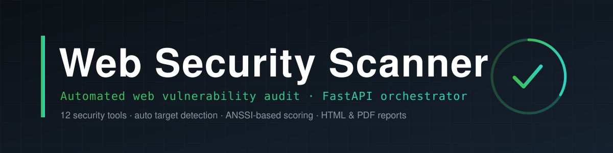
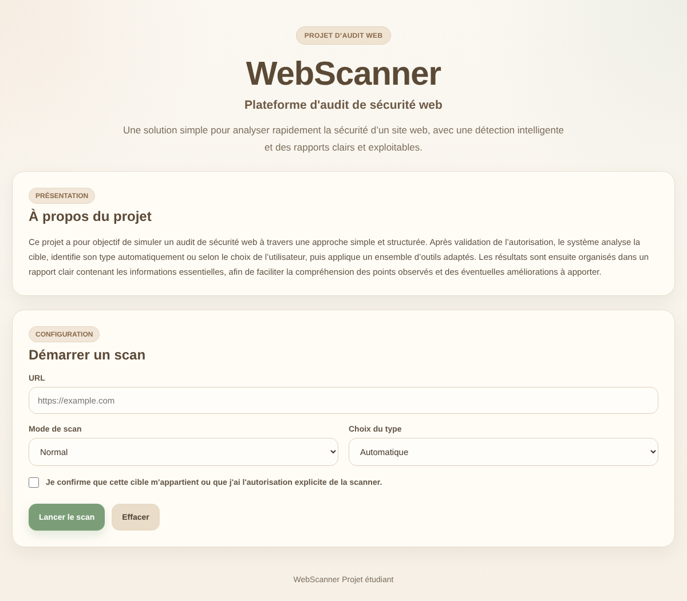
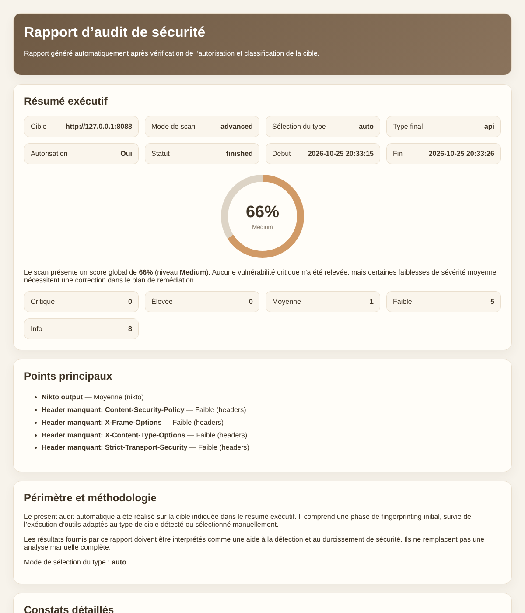

<p align="center">
  
</p>

<p align="center">
  <b>An automated web security audit platform that orchestrates 12 open-source tools, detects the target type, and produces a scored HTML &amp; PDF report.</b>
</p>

<p align="center">
  
  
  
  
  
</p>

---

## 🎯 Overview

A security auditor normally has to run many tools by hand, read each raw output, and assemble a report — slow and repetitive work. **Web Security Scanner** automates that pipeline: you provide a target URL, and the platform detects the target type, selects and runs the right tools, collects and normalizes the results, computes a security score, and generates a readable report.

The whole system follows a strict **White-Hat** approach: it only performs non-intrusive checks, requires the user to confirm authorization before any scan, and rate-limits itself to avoid any involuntary denial of service on the target.

> 🎓 University project — **SAÉ 4.CYBER.01**, BUT Networks &amp; Telecommunications (cybersecurity track), 2025–2026. ·

## ✨ Features

- **Automatic target detection** — classifies the target as a classic website, a REST API, or a WordPress site, and picks the tools accordingly (manual override available).
- **12 orchestrated tools** — Nmap, Nikto, SQLMap, Nuclei, WhatWeb, SSLScan, WPScan, Gobuster, Dirsearch, Subfinder, Amass, Dalfox.
- **Two scan modes** — *normal* (fast, essential checks) and *advanced* (exhaustive).
- **Parallel execution** — tools run concurrently via `ThreadPoolExecutor`.
- **ANSSI-based scoring** — a score out of 100 derived from each finding's severity and the tool's weight, mapped to a level (Excellent → Critical).
- **Clear reports** — summary, severity breakdown, detailed findings with impact and remediation, exported as **HTML** and **PDF** (ReportLab).
- **Authorization gate** — a scan cannot start unless the user confirms they are allowed to test the target.

## 🏗️ Architecture

```
┌───────────────┐   REST    ┌──────────────────────────────────────────┐
│   Frontend    │ ────────► │        Backend — FastAPI (Uvicorn)        │
│ HTML/CSS/JS   │           │  ┌─────────────────────────────────────┐  │
│ (static/)     │ ◄──────── │  │ ScannerService (orchestrator)       │  │
└───────────────┘   JSON    │  │  1. Fingerprint (WhatWeb, headers)  │  │
                            │  │  2. Classify target type            │  │
                            │  │  3. Run target-specific tools  ║║║  │  │ ThreadPoolExecutor
                            │  │  4. Score (ANSSI) + build reports   │  │
                            │  └─────────────────────────────────────┘  │
                            │         │                    │            │
                            │         ▼                    ▼            │
                            │     SQLite DB          HTML / PDF report  │
                            └──────────────────────────────────────────┘
```

Each tool is a small class inheriting from `BaseTool` (in `app/tools/`), which standardizes how a command is built, run (with timeout and error handling), and parsed into findings. Adding a new tool means dropping in one file and registering it.

## 🖥️ Screenshots

| Interface | Audit report |
|:---:|:---:|
|  |  |

## 📁 Project structure

```
web-security-scanner/
├── app/
│   ├── main.py                 # FastAPI app + API endpoints + target validation
│   ├── models.py               # Pydantic request/response schemas
│   ├── config.py               # Paths, DB path, worker count
│   ├── database.py             # SQLite layer (scans, findings, assets, ...)
│   ├── scoring.py              # Severity/tool weighting → score & level
│   ├── report.py               # HTML + PDF report generation (ReportLab)
│   ├── services/
│   │   ├── scanner.py          # Orchestrator: fingerprint → classify → scan → report
│   │   └── tool_registry.py    # Tool selection per mode and target type
│   ├── tools/                  # One wrapper class per security tool
│   │   ├── base.py             # BaseTool: run/parse contract
│   │   ├── nmap_tool.py · nikto_tool.py · sqlmap_tool.py · nuclei_tool.py ...
│   ├── utils/cleaner.py        # Clean/normalize raw tool output
│   └── static/                 # Frontend (index.html, app.js, styles.css)
├── docs/                       # Technical report, slides, screenshots
├── requirements.txt
└── LICENSE
```

## ⚙️ Installation

> Designed for **Linux** (Kali / Debian / Ubuntu), where the security tools are available.

### 1. Python environment
```bash
git clone https://github.com/alabri2/web-security-scanner.git
cd web-security-scanner
sudo apt install python3-venv
python3 -m venv venv
source venv/bin/activate
pip install --upgrade pip
pip install -r requirements.txt
```

### 2. Security tools
```bash
sudo apt update
sudo apt install -y nmap nikto sqlmap whatweb sslscan gobuster amass nuclei wpscan golang
go install -v github.com/projectdiscovery/subfinder/v2/cmd/subfinder@latest
go install github.com/hahwul/dalfox/v2@latest
git clone https://github.com/maurosoria/dirsearch.git
```
> A tool that is not installed is simply reported as *unavailable* in the scan — the platform keeps running with the rest.

### 3. Run
```bash
uvicorn app.main:app --reload
```
Open **http://127.0.0.1:8000**, enter a target, choose the mode, confirm the authorization, and launch the scan. The database (`scanner.db`) and the per-scan reports (`outputs/`) are created automatically.

## 🧮 How the score works

Each finding lowers the base score of 100 by `severity points × tool weight`:

| Severity | Points | | Weighted tools | Weight |
|---|---|---|---|---|
| Critical | 25 | | SQLMap | ×1.5 |
| High | 15 | | Nuclei | ×1.4 |
| Medium | 8 | | Dalfox / WPScan | ×1.3 |
| Low | 3 | | Nikto | ×1.1 |
| Info | 1 | | Nmap | ×1.1 |

**Levels:** 90–100 Excellent · 75–89 Good · 50–74 Medium · 25–49 Poor · 0–24 Critical.

## 🐛 Fixes applied to the delivered code

The code is the version delivered for the project; only the following fix was applied, with no change to the architecture or features:

- **Target input validation (security)** — the target URL is passed to the external command-line tools, so a value like `-iL /etc/passwd` or `--output=...` could previously be interpreted as a tool option (argument injection). The API now validates that the target is a real `http(s)` URL or a bare host before any tool runs. *(`app/main.py`)*

**Published copy only:** the shipped `scanner.db` (which contained the history of real test scans) and the duplicated source archive inside the project were removed; the database is recreated empty on first run.

## ⚠️ Known limitations

As documented in the technical report: no authentication on the interface, no proof-of-ownership check on the target, possible false positives from generic tools (e.g. Nikto), and SQLite/parallel limits under heavy multi-user load. See the *Améliorations possibles* section of [the report](docs/rapport-technique.pdf).

## 👥 Team — SAÉ 4.CYBER.01

Project by **Mohammed Al-Abri**, Emeer, Hazeem, Warid, Rayan, Fadlan.

## 📚 Documentation

- 📄 [Technical report](docs/rapport-technique.pdf)
- 🎤 [Presentation slides](docs/presentation-soutenance.pdf)
- 🎬 [Demo video](https://www.youtube.com/watch?v=jIlEiJvH2Xs)

## ⚖️ Responsible use

This tool must be used **only against targets you own or are explicitly authorized to test**. Unauthorized scanning is illegal in most jurisdictions. The authors accept no liability for misuse.

## 📄 License

Distributed under the **MIT** license — see [LICENSE](LICENSE).
